# Architecture Diagrams (Mermaid)

Paste each diagram into [mermaid.live](https://mermaid.live) to render as PNG/SVG for PowerPoint.

---

## Diagram 1: System Architecture Overview

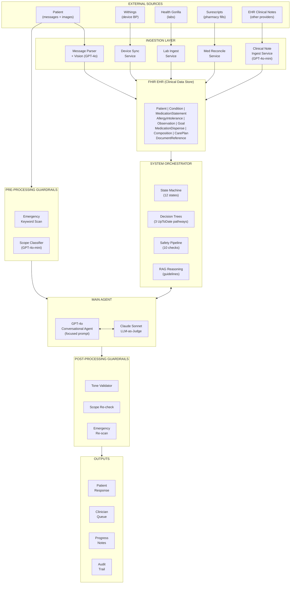

---

## Diagram 2: State Machine

The state machine has 12 states and 39 transitions. Rendering all transitions in one diagram creates unreadable crossing lines, so we split it into a **visual flow diagram** (showing the primary patient journey) and a **complete transition table** (authoritative reference for every transition).

### Diagram 2a: State Machine — Primary Flow

Universal transitions (not drawn to avoid clutter):
- **Any state → CRISIS** on BP ≥180/120 or emergency symptoms (7 inbound arrows omitted)
- **CRISIS → PENDING_CLINICIAN** always; CRISIS → AWAITING_DRUG_EFFECT after crisis resolved
- States that escalate to PENDING_CLINICIAN are marked with a dashed border

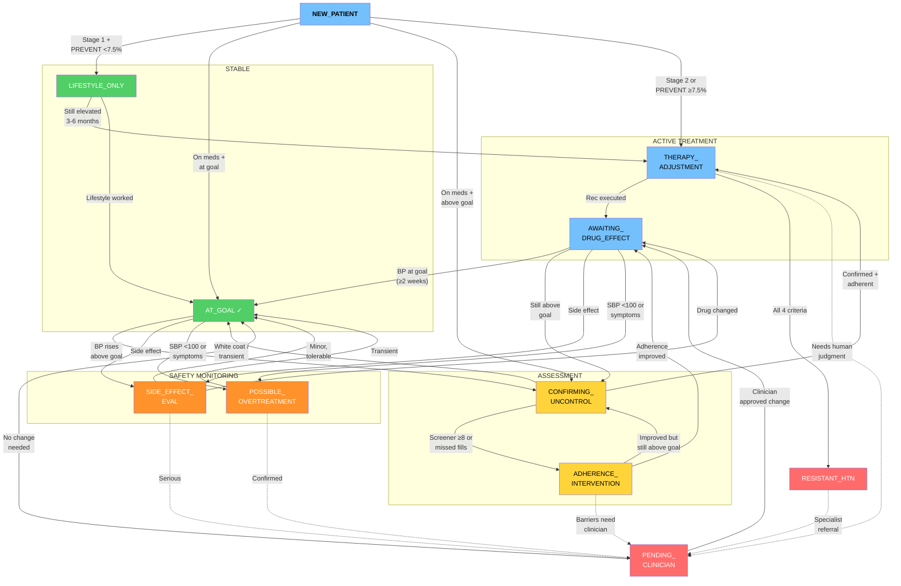

**Color key:** Green = stable/goal, Blue = entry/treatment, Yellow = assessment/confirming, Orange = safety monitoring, Red = exception/escalation. Dashed arrows (- - ->) = escalation to clinician.

### Diagram 2b: Complete State Transition Table

Every transition in the system. This is the authoritative reference — the diagram above is a visual summary.

| # | From | To | Trigger |
|---|---|---|---|
| | **Entry** | | |
| 1 | NEW_PATIENT | LIFESTYLE_ONLY | Stage 1 HTN + PREVENT <7.5% |
| 2 | NEW_PATIENT | THERAPY_ADJUSTMENT | Stage 2 HTN or PREVENT ≥7.5% |
| 3 | NEW_PATIENT | AT_GOAL | Already on meds + BP at goal |
| 4 | NEW_PATIENT | CONFIRMING_UNCONTROL | Already on meds + BP above goal |
| 5 | NEW_PATIENT | CRISIS | BP ≥180/120 or emergency symptoms |
| | **Stable states** | | |
| 6 | LIFESTYLE_ONLY | THERAPY_ADJUSTMENT | Still elevated after 3-6 months |
| 7 | LIFESTYLE_ONLY | AT_GOAL | Lifestyle modifications worked |
| 8 | AT_GOAL | CONFIRMING_UNCONTROL | BP rises above goal |
| 9 | AT_GOAL | SIDE_EFFECT_EVAL | Side effect reported |
| 10 | AT_GOAL | POSSIBLE_OVERTREATMENT | SBP <100 or hypotensive symptoms |
| | **Assessment** | | |
| 11 | CONFIRMING_UNCONTROL | AT_GOAL | White coat effect / transient spike |
| 12 | CONFIRMING_UNCONTROL | ADHERENCE_INTERVENTION | Screener ≥8 or missed pharmacy fills |
| 13 | CONFIRMING_UNCONTROL | THERAPY_ADJUSTMENT | Confirmed uncontrolled + adherent |
| 14 | ADHERENCE_INTERVENTION | AWAITING_DRUG_EFFECT | Adherence improved |
| 15 | ADHERENCE_INTERVENTION | CONFIRMING_UNCONTROL | Improved but BP still above goal |
| 16 | ADHERENCE_INTERVENTION | PENDING_CLINICIAN | Barriers need clinician involvement |
| | **Active treatment** | | |
| 17 | THERAPY_ADJUSTMENT | AWAITING_DRUG_EFFECT | Recommendation executed |
| 18 | THERAPY_ADJUSTMENT | PENDING_CLINICIAN | Needs human judgment (Layer 3) |
| 19 | THERAPY_ADJUSTMENT | RESISTANT_HTN | All 4 resistant HTN criteria confirmed |
| 20 | AWAITING_DRUG_EFFECT | AT_GOAL | BP at goal (≥2 weeks post-change) |
| 21 | AWAITING_DRUG_EFFECT | CONFIRMING_UNCONTROL | Still above goal after drug effect period |
| 22 | AWAITING_DRUG_EFFECT | SIDE_EFFECT_EVAL | Side effect reported |
| 23 | AWAITING_DRUG_EFFECT | POSSIBLE_OVERTREATMENT | SBP <100 or hypotensive symptoms |
| | **Safety monitoring** | | |
| 24 | SIDE_EFFECT_EVAL | AWAITING_DRUG_EFFECT | Drug changed / switched |
| 25 | SIDE_EFFECT_EVAL | AT_GOAL | Minor side effect, tolerable |
| 26 | SIDE_EFFECT_EVAL | PENDING_CLINICIAN | Serious side effect |
| 27 | POSSIBLE_OVERTREATMENT | PENDING_CLINICIAN | Confirmed overtreatment, downtitrate |
| 28 | POSSIBLE_OVERTREATMENT | AT_GOAL | Transient, readings normalized |
| | **Exception / escalation** | | |
| 29 | RESISTANT_HTN | PENDING_CLINICIAN | Specialist referral |
| 30 | PENDING_CLINICIAN | AWAITING_DRUG_EFFECT | Clinician approved therapy change |
| 31 | PENDING_CLINICIAN | AT_GOAL | Clinician determined no change needed |
| | **Crisis (universal — from any state)** | | |
| 32 | LIFESTYLE_ONLY | CRISIS | BP ≥180/120 or emergency symptoms |
| 33 | AT_GOAL | CRISIS | BP ≥180/120 or emergency symptoms |
| 34 | CONFIRMING_UNCONTROL | CRISIS | BP ≥180/120 or emergency symptoms |
| 35 | AWAITING_DRUG_EFFECT | CRISIS | BP ≥180/120 or emergency symptoms |
| 36 | SIDE_EFFECT_EVAL | CRISIS | Dangerous reaction |
| 37 | POSSIBLE_OVERTREATMENT | CRISIS | Syncope or fall |
| 38 | CRISIS | PENDING_CLINICIAN | Always (immediate clinician notification) |
| 39 | CRISIS | AWAITING_DRUG_EFFECT | After crisis resolved + therapy adjusted |

---

## Diagram 3: Three-Layer Decision Model

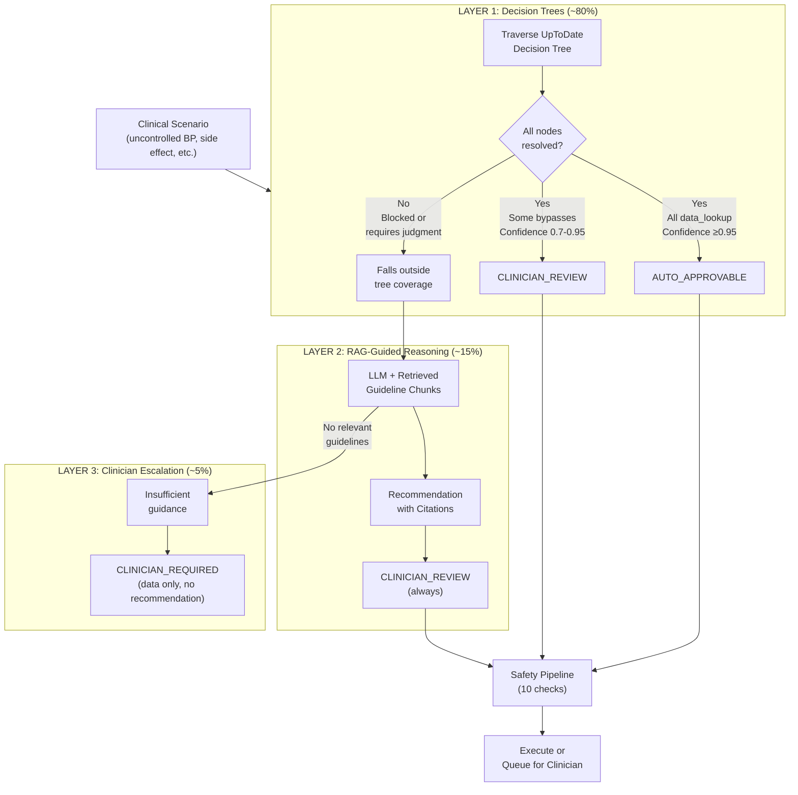

---

## Diagram 4: Safety Pipeline

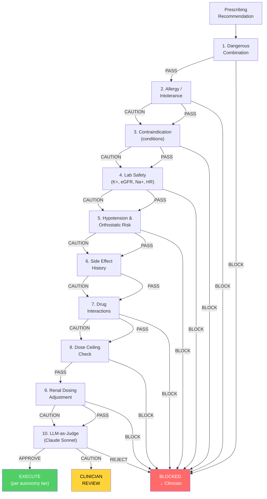

---

## Diagram 4b: Policy Architecture (Guardrail Layers)

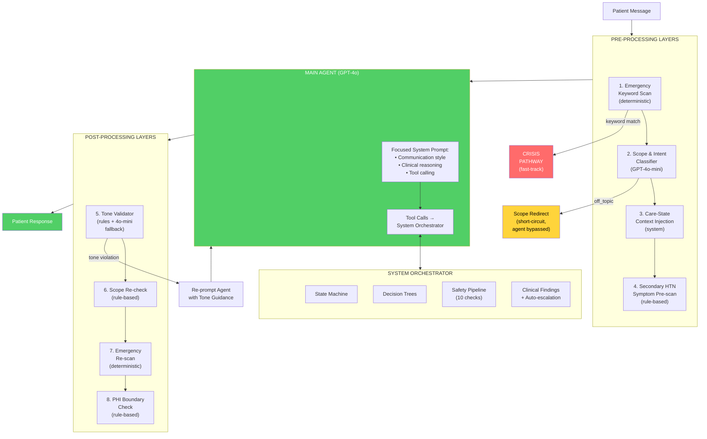

---

## Diagram 5: BP Reading Data Flow

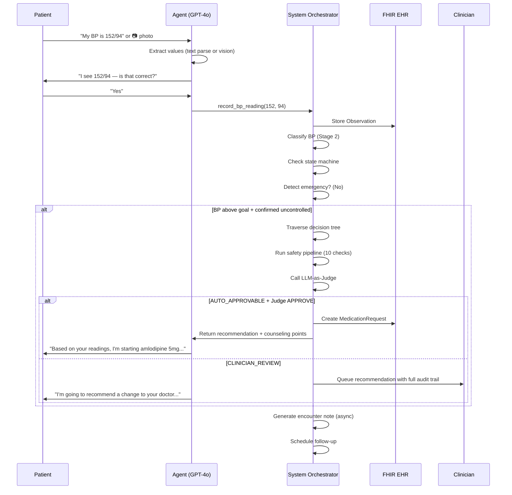

---

## Diagram 6: Emergency Detection (Two-Tier)

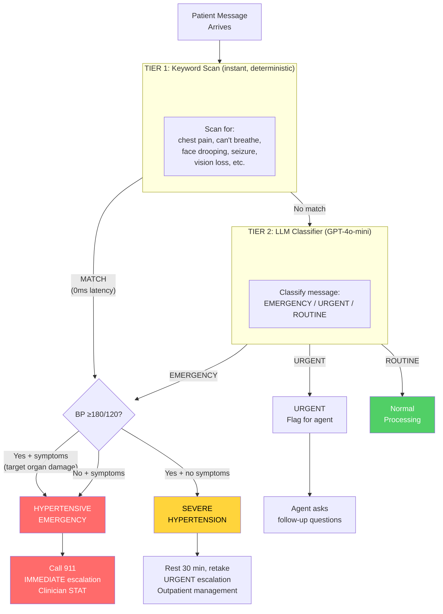

---

## Diagram 7: Autonomy Graduation Path

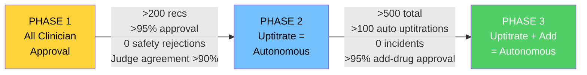

---

## Diagram 8: Adherence Gating Flow

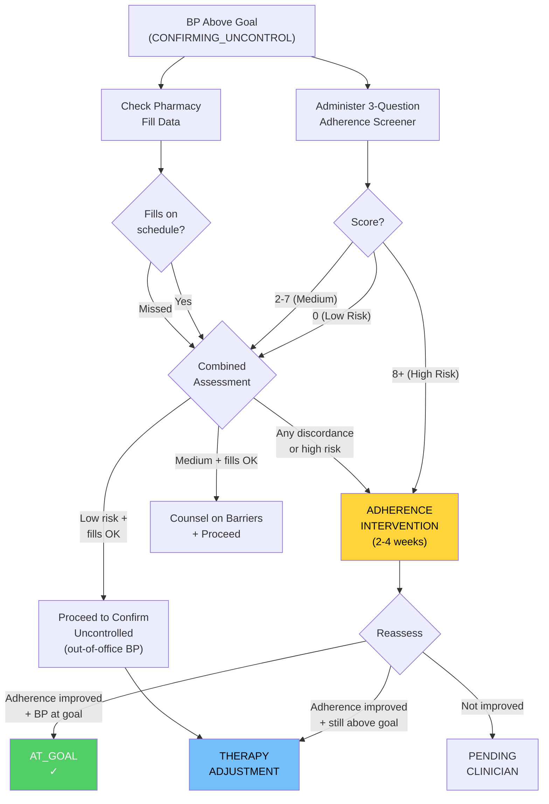

---

## Diagram 9: Clinician Queue & Actions

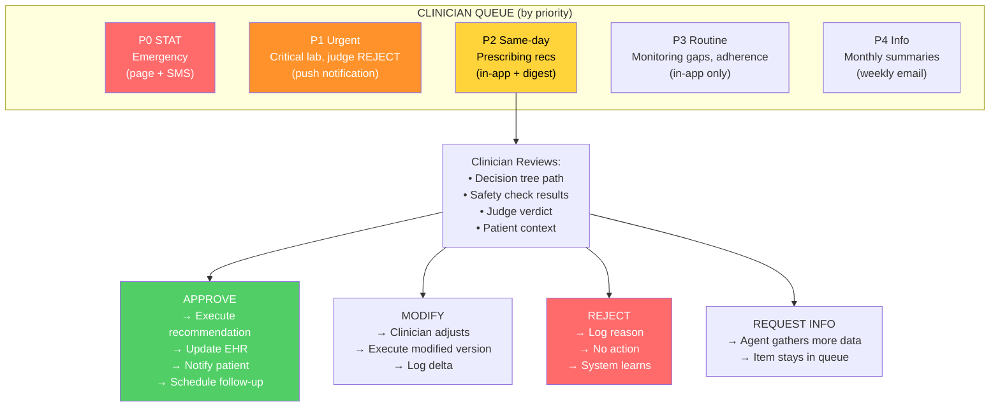

---

## Diagram 10: Implementation Phases

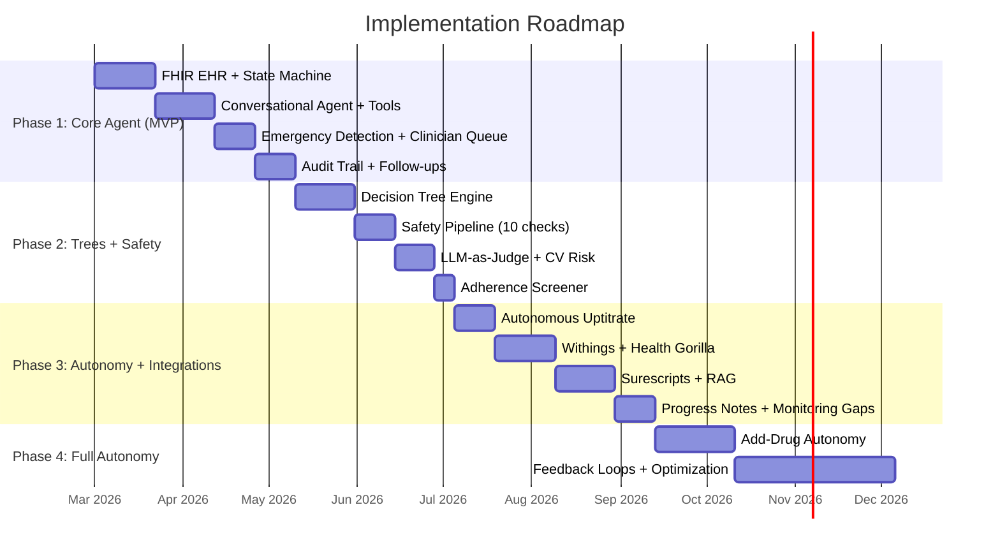

---

## Diagram 11: Clinical Problems Overview

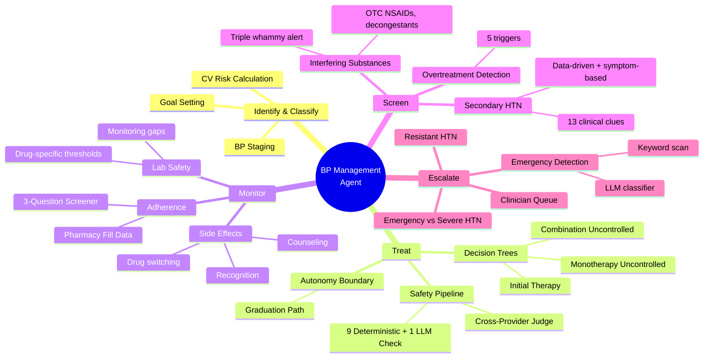

---

## Diagram 12: Conversation Management

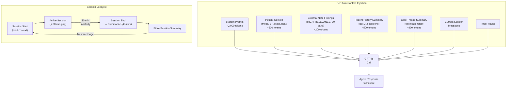

---

## Diagram 13: Tree Selection Logic

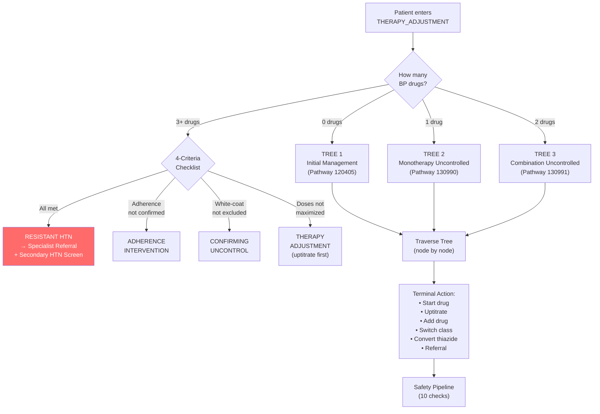

---

## Diagram 14: Model Architecture (8 LLM Roles)

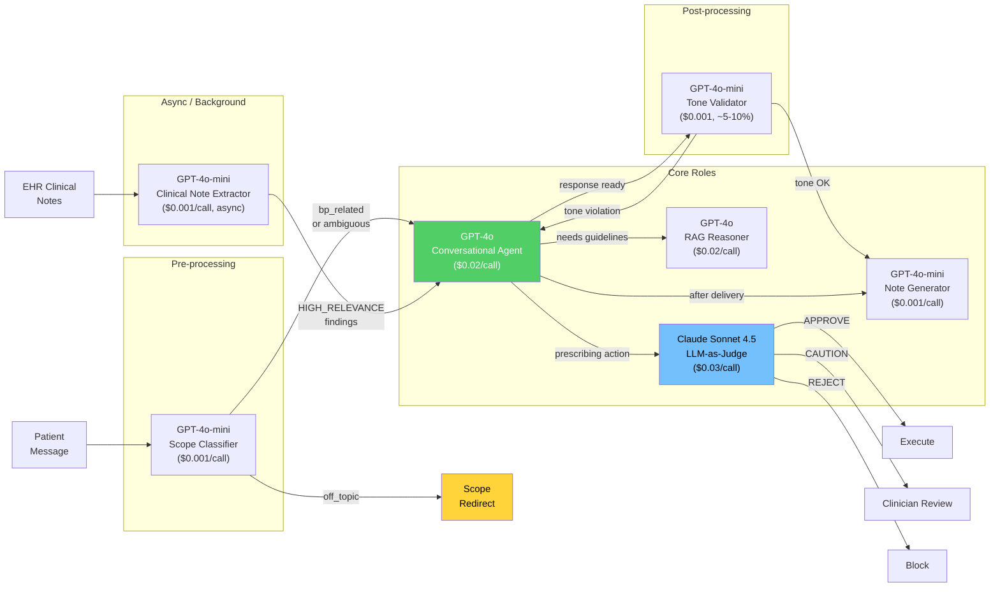

---

## Diagram 16: Prescribing Decision Flow (End-to-End)

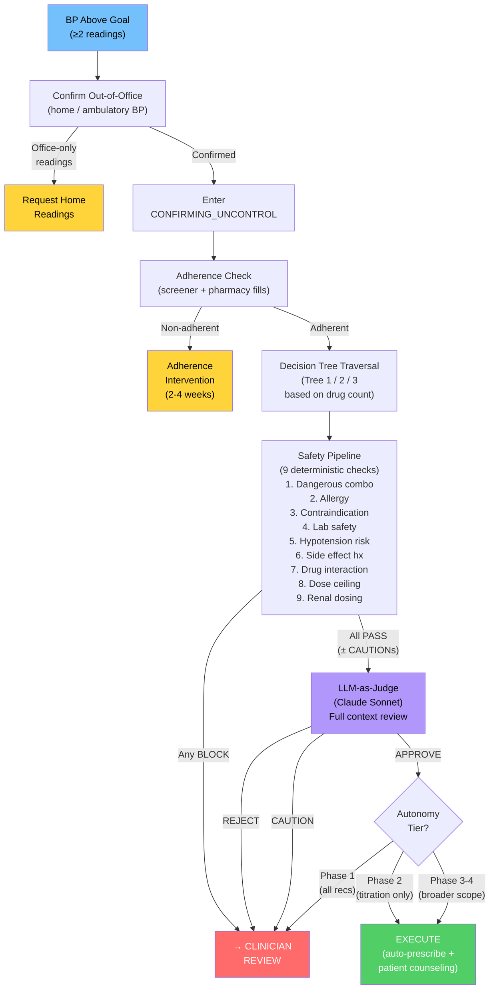

---

## Diagram 15: Secondary HTN Screening Flow

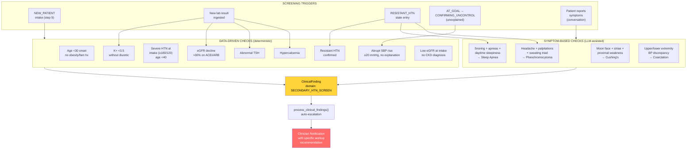
