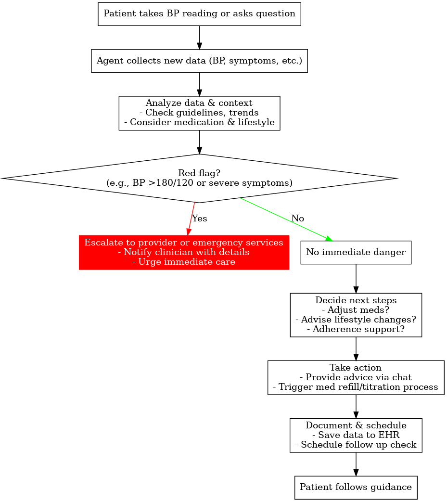

# AI Assisted Research Draft

Early ChatGPT-assisted exploration retained to show the design process. This draft contains preliminary alternatives and clinical examples; the detailed architecture takes precedence. It is not a validated care protocol.

## Autonomous Hypertension Management AI System Design

## Overview

- Goal: A comprehensive autonomous AI system to assist hypertension patients in managing blood pressure, through continuous monitoring, personalized coaching, medication management, and timely clinical escalation.
- Patient-Centered: Uses conversational AI to interact with patients in natural language, offering education, answering questions, and providing encouragement.
- Clinically Guided: Adheres to evidence-based hypertension management guidelines (e.g., ACC/AHA targets and DASH diet recommendations) while maintaining strict safety checks for high-risk situations.
- Integration-Focused: Connects with home BP devices, mobile health apps, electronic health records (EHRs), and drug databases to leverage real-time data and context for decision-making.
High-level architecture of the autonomous hypertension management AI system. Key components include:

- the patient interface (chatbot/app)
- Mobile application or chat interface through which patients converse with the AI agent. It collects user inputs (BP readings, symptoms, questions) and displays responses and educational content.
- data ingestion pipelines (home BP monitors, wearables)
- Data Ingestion & Monitoring: Pipelines that automatically gather data from home blood pressure monitors and wearables (e.g., via Apple HealthKit or Bluetooth). This module timestamps and stores readings, performs basic validation, and forwards data for analysis.
- core AI decision modules (LLM-based conversation engine, trend analysis, rules/ML decision engine, knowledge bases)
- Conversational Agent (LLM Module): Natural language engine (likely a specialized large language model) that interprets patient messages and generates human-like, empathetic responses. It is tightly integrated with the clinical decision modules to ensure advice is accurate and safe.
- Trend Analysis Engine: An analytics module that processes incoming BP readings over time, detecting trends such as sustained elevations, morning surges, or irregular patterns. It can compute statistics (weekly averages, variability) and flag anomalies or lack of control.
- Decision Engine (Guidelines + ML): The core decision-making unit combining rule-based logic and machine learning. It cross-references clinical guidelines and patient-specific data to decide on recommendations — e.g., whether to suggest a lifestyle change, adjust a medication dose, or do nothing if well-controlled. Machine learning models may predict risk (e.g., likelihood of future hypertension complications) or personalize interventions, while rule-based algorithms enforce safety (e.g., “if BP ≥ 180/120 then immediate escalation”).
- Medical Knowledge Base: A repository of clinical knowledge and data, including hypertension guidelines, the DASH diet, medication reference information (doses, side effects, contraindications), and drug interaction databases. The agent queries this to provide evidence-based answers (for example, explaining a medication’s side effects) and to check any potential medication changes for safety.
- integration points to EHR and provider alerts
- Patient Profile & EHR Database: Secure storage of patient-specific information – demographics, medical history, current medications, allergies, past BP readings, etc. The system synchronizes this with external EHRs via standard APIs (e.g., HL7 FHIR) so that it stays up-to-date with clinic records. This context is used by the decision engine to tailor recommendations (for instance, knowing a patient has diabetes would tighten BP targets).
- Safety & Escalation Module: An oversight component that monitors all decisions and patient data for safety issues. It implements explicit safety rules for edge cases: for example, detecting hypertensive crisis readings (e.g., >180/120 mmHg) or dangerous symptoms and immediately triggering an emergency protocol. This module can override or veto the AI’s autonomous actions, ensuring nothing risky is done without human oversight. It also formats alerts or summary reports to human providers when needed.
- Integration Interfaces: The system connects to external services through well-defined APIs. An EHR integration interface (using FHIR standards) allows pulling in clinical data (prior labs, clinic BP readings, problem lists) and pushing out updates (home BP logs, AI-generated visit notes or alerts). There are also connections to pharmacy systems (for medication refill status), public databases (e.g., FDA drug info API for medication details), and personal health apps (Apple HealthKit, Google Fit) for lifestyle data.
- Clinician/Provider Portal: A dashboard for doctors/nurses to review the patient’s status and the AI agent’s recommendations. It displays trends, flagged alerts, and allows clinicians to provide feedback or intervene (for example, approving a suggested medication titration or contacting the patient). This ensures a human is in the loop for significant decisions and fosters trust in the AI’s actions.
Agent Skills & Responsibilities

- Patient Interaction: The agent conducts regular conversational check-ins with patients via text or voice. It greets the patient, asks about how they’re feeling, and inquires about any symptoms or challenges. It can answer patient questions about hypertension (e.g., explaining what systolic/diastolic mean, or what a certain drug does) in an easy-to-understand manner. Using an empathetic tone, it offers motivational support — celebrating improvements (“Great job on reducing your sodium intake this week!”) and encouraging adherence (“Remember, taking your medication daily at the same time will help protect your heart.”). It also provides reminders (e.g., to measure blood pressure at the scheduled times, or to refill a prescription). The LLM-driven conversational ability allows it to understand free-form patient input and respond naturally, making the interaction feel engaging and personalized. Importantly, the agent stays within its scope, deferring or escalating if patients ask complex medical questions or express concerning issues (ensuring safety by not acting beyond its authority).
- Blood Pressure Monitoring: The agent actively monitors home blood pressure (BP) readings collected from the patient. It integrates with home BP devices (for example, using Apple HealthKit on iOS to receive measurements from a connected cuff) and can also accept manual input if the patient types in their readings. Each reading is logged with context (time of day, patient’s activity or symptoms if noted). The agent analyzes trends over days and weeks: it computes averages, detects patterns like morning hypertension or large fluctuations, and identifies whether the BP is within the patient’s target range (e.g., typically <130/80 mmHg for most adults under current guidelines). If multiple readings are above the threshold for hypertension, the agent recognizes this and might classify the level (Stage 1, Stage 2) to decide next steps. It also catches abnormal patterns – for example, if the BP suddenly spikes very high or if readings are inconsistent (which might indicate measurement error or device issues). For any abnormal readings, it prompts immediate re-checks or additional questions (“Your BP is quite high; do you have any headaches or chest pain right now?”) to assess severity. All monitoring insights are stored and can be visualized (trends graphs) and shared with the patient and provider.
- Lifestyle Coaching: Based on the patient’s data and goals, the agent provides tailored lifestyle recommendations in line with hypertension best practices. It advises on diet modifications following the DASH diet (Dietary Approaches to Stop Hypertension) principles – encouraging high intake of fruits, vegetables, whole grains, and lean proteins, while limiting saturated fats, sugar, and especially sodium. For example, it might suggest meal plans or recipes low in salt and rich in potassium. It can help set gradual dietary goals (like “reduce daily sodium to under 2,300 mg, and eventually to 1,500 mg for optimal BP control”) and track progress. In physical activity, the agent coaches the patient to achieve recommended levels (e.g., ~150 minutes of moderate exercise per week, per current health guidelines). It might integrate with fitness trackers (through APIs like Google Fit or Apple Health) to monitor steps or workouts, sending encouragement (“You walked 5,000 steps today, great work towards your activity goal!”) and gentle nudges if activity is low. Stress management is another focus: the agent can teach short breathing exercises, recommend meditation apps or techniques, and suggest stress-reduction activities (like going for a walk or practicing yoga) when it detects the patient is reporting stress or when BP readings correlate with stressful periods. For sleep, since poor sleep can affect blood pressure, the agent inquires about sleep quality and gives tips for better sleep hygiene (consistent bedtime, limiting caffeine, etc.). All coaching is done in a supportive, non-judgmental manner, and the agent adjusts recommendations based on what works for the patient, using motivational interviewing techniques to encourage gradual improvement.
- Medication Management: The agent keeps track of the patient’s antihypertensive medications and their schedule. It maintains a list of current prescriptions (sourced from the EHR medication list or patient input) including dosages and timing. Using this, it sends medication reminders at the appropriate times and asks the patient to confirm if they took the dose. If a dose is missed, the agent logs it and can provide advice (e.g., whether to take it now or skip, based on safe use guidelines) or encourages getting back on schedule. The agent monitors medication adherence trends and will address patterns of non-adherence (“I noticed you missed your evening pill twice this week. Is everything okay? Any side effects or difficulties with the medication?”). It can educate the patient on each drug’s purpose and common side effects – for instance, explaining that an ACE inhibitor might cause a dry cough, or a diuretic might increase urination. If the patient reports side effects or issues (like feeling dizzy or an annoying cough), the agent acknowledges this and checks severity, providing suggestions (such as talking to the doctor about adjusting the medication). For dose titrations, the agent follows a clinician-approved protocol: for example, if home BP remains above target for several weeks despite adherence, the agent might suggest a pre-authorized medication adjustment (like increasing a dose or adding a new drug, according to guidelines). However, any such suggestion would go through the safety module – if allowed autonomously it would be under strict rules (e.g., only if within a pre-specified range and after verifying no contraindications), or more commonly, it prepares a recommendation for a human provider to review and approve. The agent also checks for potential drug interactions or contraindications by cross-referencing the patient’s medications against a drug database (for example, ensuring that if a new drug is suggested, it doesn’t dangerously interact with current ones). Additionally, it tracks refill dates and can remind the patient to refill or even trigger an e-prescription request to the pharmacy via integration, to prevent gaps in therapy.
- Data Storage & EHR Integration: All patient data (BP readings, conversation logs, advice given, etc.) is securely stored in a database that is compliant with healthcare data regulations (HIPAA in the US). The system maintains an updated record of the patient’s profile and history that the AI agent can access when making decisions (for example, knowing the patient also has kidney disease will influence medication choices). Critically, the system is designed to integrate with external Electronic Health Records using standard protocols like HL7 FHIR (Fast Healthcare Interoperability Resources). This means it can pull in relevant data from the clinician’s chart (e.g., past clinic BP measurements, lab results like kidney function or electrolytes, problem list diagnoses, and clinician notes) to give the agent a full picture of the patient’s health. It can also write data back into the EHR: for example, uploading home BP readings as FHIR Observation resources, or writing a summary note after a month of monitoring, which the clinician can review. Integration with personal health record platforms (like Apple Health, Google Fit) allows the agent to import lifestyle data (steps, sleep hours, heart rate, weight) to correlate with BP trends. All data storage and transmission is done with encryption and strict access controls to protect privacy. The patient typically must grant permission for the agent to access their health data and share data with their providers, and all access is logged for audit.
- Clinical Escalation: The agent is programmed to recognize scenarios that require human medical intervention and to act immediately when they occur. For instance, if a home reading indicates a hypertensive crisis (systolic BP > 180 mmHg or diastolic > 120 mmHg, especially if accompanied by symptoms like severe headache, chest pain, or confusion), the agent will not attempt to handle this autonomously. Instead, it will alert the patient that this reading is dangerously high and advise urgent action, such as calling emergency services or contacting their doctor immediately. Simultaneously, the system can automatically notify the on-call clinician or care team through the provider portal or via an urgent alert (e.g., push notification or SMS to the doctor/nurse that Patient X may be in hypertensive crisis). Less acute escalations might include sustained moderate hypertension or worrisome symptoms (like signs of medication side effect requiring change) – in such cases the agent can flag the situation for review. For example, if over a week the patient’s BP has consistently been >160/100 despite adherence, the agent creates a “ticket” or message for a clinical pharmacist or physician to review the case. The escalation module prioritizes the urgency (immediate vs. within 24 hours vs. just include in next appointment) and packages relevant data (recent readings, symptoms, current meds, what the AI has done so far) to streamline the provider’s assessment. The agent’s design thus strikes a balance: it handles routine management autonomously but has clearly defined boundaries where a licensed professional must step in. This ensures patient safety – the AI won’t, for example, ignore a dangerous situation or make a high-risk decision alone. It will always “raise its hand” and get a human involved when needed, with appropriate urgency.
## External Data Sources & APIs Integration

To function effectively across monitoring, coaching, and record-keeping, the system integrates with several external data sources and services:

- Apple HealthKit (and Google Fit): These mobile health frameworks allow the agent’s app to read and write health data on a patient’s smartphone with permission. For example, the agent uses HealthKit to obtain blood pressure measurements from a connected cuff or an Apple Watch. It can also fetch heart rate, weight, exercise minutes, step count, sleep analysis, etc., which support the lifestyle coaching component. Similarly, on Android devices, Google Fit APIs can provide access to fitness and health sensor data. Using these APIs ensures device-agnostic data collection (many commercially available BP monitors sync to HealthKit/Fit, standardizing data format for the agent).
- Bluetooth Device SDKs: In cases where direct integration is needed, the system can use device-specific SDKs or standards like Bluetooth Low Energy (BLE) profiles for blood pressure. This allows real-time capture of readings from home monitors if they are not already syncing via a phone’s health app.
- Electronic Health Records (Epic FHIR API, etc.): The agent connects to EHR systems (such as Epic, Cerner, etc.) through their FHIR-compatible APIs. For example, Epic’s API (using FHIR) can allow the agent to pull the patient’s problem list, medication list, allergy list, and recent clinic vitals. It can query the FHIR Observation resource for any blood pressure measurements recorded in clinic, to compare home vs office readings. It can use the MedicationStatement/MedicationRequest resources to retrieve current prescriptions from the medical record. When updating the EHR, the agent can post new observations (home BP readings as FHIR Observations) or notes (using a FHIR CarePlan or DocumentReference for a summary report). This interoperability ensures the AI’s actions are not in a silo – the patient’s doctors are kept in the loop with the latest data, and the agent is aware of the official care plan.
- FDA and Drug Information Databases: To support medication management, the system accesses authoritative drug data. For instance, it may use the FDA’s open APIs (such as OpenFDA) or databases like RxNorm to get standardized drug information. These sources can provide details on drug indications, typical dosage ranges, side effects, and contraindications. The agent uses this to double-check any medication changes (ensuring a suggested dose is within safe limits, or identifying if two drugs shouldn’t be combined). Additionally, drug interaction databases (e.g., from First Databank or Micromedex if integrated) can be queried whenever a new medication is considered – if a potential interaction is found (say the patient’s on Medication A and adding Medication B could cause an issue), the agent will flag it and likely avoid that suggestion or clearly warn the provider.
- Clinical Guidelines Repositories: The agent references current clinical guidelines for hypertension (for example, ACC/AHA hypertension guideline recommendations) which might be stored in a structured form or accessed via an API. Some platforms provide machine-readable guidelines or an API for medical knowledge (e.g., a CDS – Clinical Decision Support – service). If available, the agent could query such services to ensure its recommendations align with the latest evidence. In practice, the guidelines might be encoded internally as part of the knowledge base or rules engine rather than an external API, but staying updated with sources like professional societies is key.
- Lifestyle and Nutrition Databases: For richer coaching, the system can tap into external data like nutrition databases (for example, the USDA food composition database) to help calculate salt intake from a patient’s logged meals, or use third-party services that provide healthy recipe suggestions. It might integrate with apps like MyFitnessPal or Apple’s nutrition tracking to retrieve the patient’s dietary logs if available, and then provide feedback based on sodium/potassium intake.
All external integrations are implemented via secure APIs with the necessary authentication (OAuth2 for health APIs, API keys for others, and HL7-compliant security for EHR connections). The system strictly abides by data-sharing permissions: patient consent is required to link their EHR or wearable data, and they can revoke access at any time. Each integration point is tested for compliance and data accuracy to maintain trust in the system’s inputs and outputs.

## Data Flow from Patient Interaction to Clinical Action

Figure: High-level data flow depicting how patient inputs lead to AI actions and potential clinical escalation. The flowchart illustrates the sequence from a patient taking a blood pressure reading through the agent’s analysis, decision-making, and resulting outcomes (advice or escalation).

- Patient Input – Initiation: The process typically begins with the patient, either measuring their blood pressure or engaging the agent in conversation. For instance, the patient’s connected BP cuff records a reading and sends it to the mobile app, or the patient might message the agent saying, “I have a headache today.” The patient’s action (measurement or message) serves as new input data for the system.
- Data Collection: The new data is immediately collected by the agent’s interface. In the case of a BP reading, the value (e.g., 168/102 mmHg) along with timestamp and any metadata (which arm, body position, etc., if provided by device) is ingested. If it’s a patient query or symptom report, the conversational agent parses the text to extract meaning (e.g., “headache” might be flagged as a symptom possibly related to BP elevation). All inputs are forwarded into the core system for processing.
- Analysis & Interpretation: The agent’s analytic modules assess the incoming information in context. The Trend Analysis Engine updates the patient’s BP graph and compares this reading against recent values and target ranges. It might note, for example, that 168/102 is above the patient’s goal and is part of a rising trend over the last week. Simultaneously, the Decision Engine evaluates rules: it checks if this reading crosses any danger threshold (is it a red-flag value?). In our example, 168/102 is high (Stage 2 hypertension range) but not yet in the “crisis” range; thus, no immediate emergency trigger, but it is significant. The engine also looks at context: is the patient on medication? Are they having symptoms (the mention of “headache” is noted)? This context is used to determine the significance – a moderately high BP with a headache could be concerning. The agent could also run an ML risk model here to predict if this pattern suggests the patient is likely to have sustained hypertension that needs intervention.
- Immediate Safety Check: Before proceeding with any advice, the Safety & Escalation Module performs an immediate check: Is this a red flag situation? For example, is the BP reading in a hypertensive emergency range or is the patient reporting severe symptoms that could indicate something like stroke or organ damage? This decision diamond (as shown in the flowchart) triages the scenario. If Yes (danger present), the flow goes to the emergency handling path. If No (no immediate danger), it continues with normal processing. In our example, 168/102 with a mild headache is not an immediate emergency (not above 180/120 and patient is conversant), so the “No” branch is taken – but the system will keep an eye on it.
- Emergency Handling (if needed): For a Yes at the safety check (e.g., patient’s BP came in at 185/123, or they text “I have chest pain and vision changes”), the agent initiates the clinical escalation protocol. It will instantly compose a clear alert to the patient: e.g., “Your blood pressure reading is extremely high. This could be dangerous. Please seek immediate medical attention or call 911.” Meanwhile, it triggers notifications to the clinical team (sending an urgent alert with the data and perhaps recommending an ER visit). Depending on design, it might also phone the patient if possible or instruct them in real-time steps (like lie down, stay calm, help is being contacted). This branch leads to provider/emergency involvement and the agent will await further instructions; it essentially hands off control to human responders at this point. The flow for that event ends with the patient receiving urgent care, beyond the agent’s autonomous scope.
- Decision on Next Steps (Normal Path): If no crisis is detected, the agent proceeds to decide on appropriate next steps for routine management. The Decision Engine considers a range of actions: Does the medication regimen need adjusting? Is this a coaching opportunity? Should it ask the patient more questions? Using the knowledge base and rules, it might conclude, for example, that the patient’s BP has been above goal for a week now despite being on medication – indicating a need for improved adherence or a medication change. It also factors in the patient’s message about a headache: perhaps prompting it to check if the headache is likely due to high BP or a med side effect. The outcome of this decision process could be one or multiple actions: e.g., ask about medication adherence, suggest a lifestyle tweak, and prepare a med change suggestion for review. The agent prioritizes interventions that are least invasive first (e.g., if the patient admits they forgot pills, focus on adherence rather than immediately upping the dose).
- Agent Action & Response: The agent now takes action based on the decisions. It will respond to the patient through the conversational interface with helpful advice or next questions. For example: “Your BP is still above the goal. Have you been able to take all your doses of Lisinopril this week?” – gathering adherence info. If the patient says they missed doses, the agent might focus on solving that (tips to remember, maybe setting an alarm, addressing side effects). If adherence is fine, the agent might say, “We may need to adjust your treatment. I’ll inform your doctor. In the meantime, let’s keep an eye on your salt intake – try choosing low-sodium options and continue your evening walks.*” Alongside the chat, if a medication change seems needed, the agent drafts a recommendation for the provider (e.g., suggesting increasing the Lisinopril dose or adding a diuretic) for review. The patient gets immediate feedback and guidance, and knows that the agent is doing something about the trend (which improves engagement and trust). For lifestyle, the agent might set a specific goal: “This week, try to eat at least one extra serving of vegetables at lunch or dinner, and use herbs instead of salt for seasoning.” All these actions are delivered in a patient-friendly manner via the app.
- Documentation & Scheduling: After responding, the agent documents the interaction and outcome. The new BP reading and the agent’s analysis (and any patient responses about adherence or symptoms) are saved to the patient’s record. If integrated with the EHR, it may log a note or update a running “remote monitoring” report that the clinician can see. The agent might also update a task list for follow-up (for example, scheduling the next check-in message or planning a follow-up in a few days to see if actions helped). If a provider review is needed (e.g., for medication change), the system ensures that is logged as an open issue and reminds the provider if not addressed within a set timeframe. Essentially, the loop closes with all data stored and the next cycle of care scheduled, whether that’s the agent’s next chat tomorrow or a telehealth appointment that the agent proposes for the patient due to persistent issues.
- Provider Intervention (if escalated): In cases where the agent had to escalate (either urgent or non-urgent), a clinician will review the situation via the provider portal or notification. They might then directly intervene – e.g., call the patient, call in a new prescription, or give the agent authorization to implement a change. The system design ensures that whenever the agent defers to a human, it provides a concise summary and its own reasoning/recommendation to assist the provider’s decision. The final clinical action (like doctor increasing a dose) is then fed back into the system (the medication list is updated, etc.), and the agent will adjust its management accordingly going forward.
This data flow repeats in a continuous loop throughout the patient’s management, forming a closed-loop system: patient data in, AI analysis, appropriate response or escalation, outcomes recorded, and back to monitoring. The approach ensures timely interventions – small issues are managed immediately by the AI, and serious issues get rapid human attention, aiming to keep the patient’s blood pressure in a safe range and their care team informed.

## AI & ML Components and Technologies Used

The system employs a combination of advanced AI models and rule-based logic, carefully orchestrated to maximize patient benefit while minimizing risks:

- Conversational LLM: At its core, the agent uses a Large Language Model (LLM) to handle natural language understanding and generation for patient interaction. This could be a model in the GPT-4 class (potentially a fine-tuned healthcare-specific variant) or another state-of-the-art NLP model trained on medical dialogues. The LLM allows the agent to interpret free-form patient inputs (questions, descriptions of how they feel) and generate coherent, contextually appropriate replies. For example, if a patient asks “Why do I need to limit salt?”, the LLM can generate an explanation about sodium’s impact on blood pressure. However, unlike a generic LLM, here it’s deployed in a controlled manner: the system uses a retrieval-augmented approach where factual information (e.g., recommended salt limits from guidelines) is retrieved from the knowledge base and provided to the LLM to incorporate into the answer, reducing the risk of hallucinations. The LLM is also instructed with guardrails – for instance, it should use a reassuring tone, avoid giving any off-label medical advice not vetted by guidelines, and default to escalation if unsure. A separate NLU pipeline may classify the intent of patient messages (e.g., distinguish a routine check-in vs. a symptom report vs. an urgent distress message) to help route the conversation appropriately.
- Rule-Based Clinical Decision Engine: Given the high stakes in medical recommendations, the system relies on a robust set of rule-based algorithms derived from clinical guidelines and expert knowledge. These encoded rules cover critical decision points: for instance, “IF average BP > X for Y days AND adherence is confirmed, THEN consider medication intensification” or “IF patient reports symptom A while on drug B, THEN check for side effect interaction.” The rules ensure that the agent’s actions align with standard care pathways. Many of these rules come directly from published guidelines (e.g., how to titrate medications or when to add a second drug) and from safety requirements (like thresholds for escalation). The advantage of rule-based logic is predictability and transparency; clinicians can review these rules and be confident the AI isn’t doing something crazy. The system might use a clinical decision support engine or a business rules management system to manage and update these rules as guidelines evolve.
- Machine Learning & Personalization: In addition to the LLM, other ML models contribute to more nuanced decision-making. For example, an anomaly detection model might analyze a time-series of BP readings to detect measurement errors or unusual patterns beyond simple threshold rules. A classification model could stratify patients by risk (using features like BP variability, comorbid conditions, and adherence) to determine who needs more aggressive intervention versus who is likely fine with lifestyle changes alone. Over time, the agent can employ reinforcement learning or adaptive algorithms to personalize recommendations: learning which type of coaching messages a particular patient responds to best, or what time of day the patient is most engaged, and adjusting its strategy accordingly. Any machine learning is deployed under supervision – e.g., if an ML model predicts a certain patient would benefit from a beta-blocker, that suggestion is cross-checked with the knowledge base and possibly requires clinician approval. The rationale for including ML is to handle the variability between patients: not everyone responds the same to a given diet or drug, so the agent can learn patterns (from the individual and from aggregated data across users) to refine its care recommendations beyond one-size-fits-all rules.
- Knowledge Base & Retrieval System: The agent’s medical knowledge is stored in a structured format, including a database of hypertension-related facts, guidelines, and patient education content. This might involve a combination of knowledge graphs (linking concepts like “ACE inhibitor” -> “side effect: cough”) and document repositories (such as PDF guidelines or web content from reputable sources). The system uses an indexing and retrieval mechanism to fetch relevant information on demand. For instance, if the agent’s conversation requires explaining the DASH diet, it will retrieve key points (e.g., “focus on fruits, veggies, whole grains, and low-fat dairy; limit foods high in saturated fat and sugar”) and then the LLM will phrase it conversationally for the patient. The knowledge base is also used by the decision engine: e.g., it stores threshold values (target BP <130/80 for most patients, or <140/90 for certain populations, etc.), and medication protocols. Maintaining this as a distinct module allows easy updating when guidelines are updated or new research emerges. Safety guardrails are part of this knowledge base too – for example, known dangerous drug interactions or contraindications are listed so the agent can automatically check any plan against them.
- Context Tracking and Memory: The system implements a mechanism for tracking context over time. This includes short-term conversation context (so the agent remembers what the patient said earlier in the chat and can refer back without the patient re-explaining) and long-term medical context (so it “remembers” the patient’s history and previous interactions from day to day). Technically, this might use vector embeddings for semantic memory of past conversations, or simply a secure log of recent exchanges that is summarized and provided to the LLM on each turn (to stay within token limits). For the long-term patient data, the profile database serves as memory. This ensures continuity, e.g., if a patient mentioned last week that they were going on vacation (which might disrupt routines), the agent can follow up about it later.
- Monitoring and Logging Tools: The AI system includes monitoring sub-systems that continuously log its interactions and decisions. These logs are used for both audit (to ensure compliance and allow retrospective analysis by developers/clinicians) and performance improvement (feeding data into retraining the models or refining rules). There might be a dashboard where authorized staff can see metrics like: how many times the agent had to escalate to a human, average reduction in BP for users over 3 months, common questions patients ask, etc. From an AI safety perspective, these logs help detect if the LLM ever gave an inappropriate response or if any decision was erroneous, so it can be corrected.
- Safety Filters and Guardrails: In addition to the high-level Safety module decisions, the system implements content filtering on the LLM’s outputs (to ensure no sensitive or inappropriate content is generated), and rate limiters on actions (the agent cannot spam the patient with too many messages or make too frequent changes). There is also likely a validation layer whenever the agent is about to give a medical advice or recommendation: this layer double-checks that the advice is among the allowed set of guidance determined by clinical experts. For example, the agent might generate a message “Maybe you should double your dose” – the validation layer would catch that and forbid it unless it’s part of an approved protocol. Instead, it might modify the message to “We might need to adjust your dose; I’ll consult your doctor before we make any changes.” This way, the LLM’s creativity is bounded by safety rules.
- Underlying Infrastructure: The entire system runs on a secure, scalable infrastructure. The AI models (LLM and others) might be hosted on cloud services that are configured for health data (HIPAA-compliant cloud environment with encryption). The app and integration services communicate with the backend over HTTPS with strong encryption. Databases use encryption at rest. Access to models and data is managed by authentication and role-based access control (the patient can access their data, the clinicians can view relevant patient data, but no one can access someone else’s data without authorization, etc.). The design also considers fallback modes – e.g., if the LLM service is down or unreachable, the agent will politely inform the patient of technical difficulties rather than just failing silently.
This blend of technologies – a friendly conversational front-end powered by a constrained LLM, a sturdy rule-based backbone, supportive ML models for personalization, and comprehensive knowledge integration – is chosen to ensure the system is intelligent yet reliable. By leveraging state-of-the-art AI for understanding and personalization, while keeping critical medical decisions under stringent logic and oversight, the system aims to provide the best of both worlds: dynamic patient engagement and rock-solid clinical safety.

Patient safety is paramount in this autonomous agent design. Several layers of explicit safety logic and policies govern the agent’s behavior, especially in edge-case scenarios:

- Hypertensive Crisis Detection: The system is hard-coded with threshold-based rules to catch dangerously high BP readings. For example, any reading ≥180 mmHg systolic or ≥120 mmHg diastolic is treated as a potential hypertensive crisis. The agent will immediately verify the situation: it might ask the patient to remeasure in 5 minutes (sometimes devices error or a rest can change it), but simultaneously it prepares to act. If the high reading persists or if the patient also reports severe symptoms, the agent triggers an emergency escalation. No autonomous coaching or wait-and-see occurs in this scenario – it is treated as an emergency by default. This includes instructing the patient to seek urgent care and alerting clinicians. By design, the agent will not attempt any medication change or give reassurance like “take an extra pill and lie down” in a crisis; it recognizes this is beyond its scope and that immediate human medical intervention is needed. This rule is based on clinical best practices that hypertensive emergencies require rapid blood pressure reduction in a controlled setting.
- Symptom Red Flags: Beyond raw BP values, the agent’s conversation monitoring is always on the lookout for keywords or indications of serious conditions. For instance, if a patient mentions symptoms like chest pain, shortness of breath, neurological deficits (e.g., slurred speech, weakness), or severe headache with vision changes, these could indicate heart attack or stroke. The presence of such symptoms in a hypertensive patient is an automatic red flag. The agent’s NLP intent classification would tag these and immediately escalate. It would respond with something like, “Those symptoms could be serious – I’m alerting your doctor right now. If you feel worsening or are very concerned, call emergency services.” Even if the BP reading isn’t extremely high at that moment, the combination of symptoms and moderate hypertension could signal an urgent issue (e.g., hypertensive emergency with organ damage). Thus, symptom checking is a critical safety net. Similarly, if a patient ever types something suggestive of self-harm or extreme distress (outside pure hypertension, but in general mental health), the agent has protocols to handle that safely (usually by providing crisis resources or contacting emergency responders as appropriate).
- Medication Safety and Interactions: The medication management function has multiple guardrails. When suggesting any titration (dose increase or adding a new drug), the agent cross-checks:
- Maximum Dose Limits: It knows the recommended maximum dose for each medication (from the drug database). It will not suggest a dose beyond those limits and will flag if the current dose is already high.
- Drug Interaction Check: For any new medication suggestion, an interaction check is performed against the patient’s current meds. For example, if the patient is on an ACE inhibitor and a diuretic, adding an ARB would be duplicative (another RAAS blocker) – the agent should avoid redundant therapy. Or if the patient is on a medication that increases potassium, the agent would be cautious adding another that also raises potassium (to avoid hyperkalemia). Known severe interactions (like certain combinations that could cause dangerous bradycardia or electrolyte issues) are explicitly listed in the system and will outright block those suggestions. The agent might instead recommend an alternative or simply escalate to a doctor with a note “patient needs med change but has complex regimen – manual review required.”
- Allergy and Contraindication Check: The agent references the patient’s allergy list and problem list from the EHR. If the patient is allergic to say, hydrochlorothiazide, obviously the agent won’t ever suggest a thiazide diuretic. If the patient has a condition like pregnancy, the agent avoids contraindicated drugs (e.g., no ACE inhibitors for pregnant patients, per guidelines). These are black-and-white rules to prevent dangerous errors.
- Adherence Check before Change: As a rule, the agent avoids suggesting aggressive medication increases until it has verified that poor control isn’t simply due to not taking the medication correctly. This is a safety and best-practice measure: many times hypertension is uncontrolled because the patient isn’t actually taking the med daily. The agent will thus, upon seeing high readings, first engage the patient about adherence and lifestyle. Only after confirming those are optimized (or if the situation is too urgent to wait) will it move to medication changes. This prevents unnecessary polypharmacy or overdosing a patient who might just need behavioral support.
- Full Autonomy vs. Clinician Involvement – Defined Boundaries: The design carefully delineates what the AI agent handles autonomously versus when it must involve a human clinician. Routine tasks — education, lifestyle counseling, reminding the patient, logging data — are fully autonomous. Even moderate interventions like suggesting using a pillbox for adherence or proposing the patient try measuring BP at a different time are autonomous. However, any decision that would change the patient’s treatment plan in a significant way is either pre-authorized via protocol or requires clinician approval. For example:
- Medication Changes: The system might operate under a clinical protocol (similar to how nurses or pharmacists in hypertension programs do) that if BP remains above X for Y weeks, then increase drug A by Z mg – but such protocols are typically approved by the overseeing physician in advance. The agent can execute them if they are explicit standing orders. If not, the agent will instead draft a recommendation and send to the doctor for sign-off. This ensures no unsupervised medication changes outside of a defined safe scope.
- Diagnoses: The agent does not make new diagnoses. If the patient develops, say, signs of a new condition (like renal artery stenosis suspicion), the agent will flag it for a doctor. It won’t tell the patient “you might have disease X” on its own.
- Out-of-scope Questions: If a patient asks a question unrelated to hypertension or something that requires a clinician’s judgment (“Should I take this cold medicine with my blood pressure pill?”), the agent will provide general info but ultimately encourage consulting with a pharmacist/doctor for confirmation. This keeps the system’s liability and risk in check.
 By structuring it this way, the system balances autonomy with safety. Full autonomy is used only in low-risk, well-defined situations (benefiting efficiency and patient convenience). Clinician involvement is pulled in for high-risk or ambiguous situations (ensuring quality of care). Over time, as the AI proves its reliability, the scope of autonomy can expand under careful monitoring, but always with fail-safes.
- Human-in-the-Loop and Override: Even when the agent is acting autonomously, it provides transparency and opportunities for human override. Clinicians have access to the portal where they can see what the agent is doing. If a provider disagrees with an approach (say the agent keeps focusing on diet but the doctor thinks medication should be changed sooner), the provider can step in, adjust the plan, or update the agent’s rules. The system could have a feature where providers “tune” certain parameters (like setting a patient-specific BP target, or marking that patient should not get a certain med). The agent respects these inputs. Furthermore, any time an escalation happens, the human provider effectively takes over until the crisis is resolved – the agent switches to support mode (providing information and logging data, but not making decisions). This human-in-the-loop design is critical for meeting regulatory requirements and clinician acceptance.
- Audit Trails and Explanations: For safety and accountability, every recommendation the agent makes can be traced and explained. The system logs the reasons behind a decision (e.g., “Suggested increasing dose because average BP past 2 weeks = 150/95, above target 130/80, patient already on moderate dose, adherence confirmed, per protocol X”). These explanations can be shown to clinicians and even patients if appropriate. This not only builds trust, but also helps in case the agent’s advice is ever questioned. Developers and clinical overseers can review these logs to refine rules or correct any issues (for example, if a rule was too aggressive or a threshold too low causing excessive alerts).
In summary, safety is built into every layer of the autonomous agent. The combination of strict rule triggers for emergencies, comprehensive medication checks, defined limits of autonomy, and human oversight ensures that while the system is proactive and helpful, it will always default to caution and seek human help when a patient’s wellbeing could be at risk. The result is a system that can act quickly for routine matters, but doesn’t take unsafe shortcuts in the care of a complex condition like hypertension.

## Clinical Best Practices and Guidelines Compliance

A strong design principle for this AI agent is alignment with established clinical best practices for hypertension management. The system was developed in consultation with current guidelines and expert consensus to ensure its recommendations are appropriate. Key aspects include:

- Evidence-Based Targets: The agent uses recommended blood pressure targets as per guidelines (for example, generally aiming for <130/80 mmHg for adults under 65, or individualized targets for older patients and those with comorbidities). It knows the categories of BP (normal, elevated, Stage 1, Stage 2) and acts accordingly – e.g., stage 1 hypertension might warrant lifestyle focus, whereas stage 2 (especially with risk factors) likely needs medication, in line with guidelines. These thresholds are kept up-to-date; if new research or guidelines adjust targets or treatment thresholds, the knowledge base is updated so the agent’s advice stays current.
- Lifestyle First Approach: Consistent with clinical advice, the system places heavy emphasis on lifestyle modifications as the first-line intervention for most patients with mild to moderate hypertension. It coaches on weight loss (knowing that even a 5-10% weight reduction can significantly lower BP), dietary salt reduction (targeting <2.3g sodium, or <1.5g for higher risk, as recommended by organizations like the AHA), increased potassium intake (through diet, unless contraindicated), regular exercise (following CDC/AHA guidelines of ~150 minutes/week moderate activity), moderation of alcohol, and smoking cessation. These are all evidence-backed measures to improve blood pressure. The agent’s advice in these areas is based on authoritative sources (NIH’s DASH diet research, etc.), and it prioritizes them especially for patients who are pre-hypertensive or have only mild elevation. It will still encourage lifestyle improvements for those on medication, as this complements pharmacotherapy.
- Stepwise Medication Titration: The agent’s medication management logic mirrors what a careful clinician would do: start with first-line medications and titrate slowly while monitoring. For example, initial drug choices might be a thiazide diuretic, ACE inhibitor, ARB, or calcium-channel blocker (reflecting major guidelines). The agent won’t suggest less proven treatments until those are maximized. It also will titrate one change at a time and then observe – this follows best practice of adjusting gradually and avoiding multiple changes simultaneously which can confuse what caused an effect or side effect. The agent also respects that some patients need combination therapy (if BP is >20/10 mmHg above goal, guidelines often recommend starting two meds); such nuance can be built into its rule base. By coding these guideline-based algorithms, the agent helps standardize hypertension care to what evidence shows works best (this can reduce therapeutic inertia and ensure patients aren’t left uncontrolled for too long).
- Patient Education and Empowerment: Best practices aren’t only about numbers, but also about patient engagement. The system is designed to educate patients on their condition, which is known to improve compliance and outcomes. It provides credible information (akin to what a doctor or nurse educator would share) about hypertension’s risks (e.g., “uncontrolled high BP can lead to stroke, heart attack, kidney damage over time”) and the importance of each aspect of management. It does so gradually and contextually to avoid overwhelming the patient — for instance, giving a small teaching point when it’s relevant to something the patient is experiencing. The educational content is sourced from high-quality materials (like AHA brochures or NIH resources) and reviewed by clinicians. This ensures consistency with what the healthcare team would want patients to know, thus reinforcing the care team’s messages.
- Personalization within Guidelines: While guidelines provide a one-size-fits-most blueprint, the agent also understands when to individualize. For older patients or those with certain comorbidities, it might adopt a slightly higher BP target if that’s what the provider prefers (some guidelines allow looser control in frail elderly, for instance). If a patient has diabetes or kidney disease, the agent knows to be more aggressive (those patients often have stricter goals like <130/80 as per ADA and KDIGO guidelines). It takes into account medication intolerances or past history (maybe the patient tried a beta blocker before and didn’t do well — the agent won’t suggest it again). These nuances come from the EHR data and patient history being incorporated. Essentially, the agent follows a “protocol, unless there’s a reason not to” approach – meaning it sticks to standard care paths but is smart enough to modify the plan if the patient’s specific situation calls for it (much like a clinician would).
- Continuous Updates and Clinical Oversight: The medical domain evolves, and so the agent must too. The system is designed to be updated as guidelines change (for instance, if new trials suggest a different ideal BP range, or a new medication becomes first-line). There is a process for clinical experts to update the rules/knowledge base periodically. Moreover, the agent’s recommendations can be reviewed in aggregate by a clinical committee to ensure they align with best practices. If any pattern of suboptimal advice is spotted, the underlying logic is revised. This learning healthcare system approach means the AI not only follows current best practices, but helps define future best practices by collecting data on what works and feeding that back into research (with appropriate de-identification of patient data for privacy).
By grounding the AI’s behavior in established clinical best practices and maintaining a feedback loop with human experts, the system aims to deliver care that is not just autonomous and convenient, but effective and trustworthy. Patients and providers can feel confident that the agent’s advice is the same they would get from a knowledgeable clinician working from the latest hypertension guidelines.

## Privacy, Security, and Regulatory Considerations

Designing an AI system for healthcare requires stringent attention to patient privacy, data security, and regulatory compliance:

- HIPAA-Compliant Data Handling: All personal health information (PHI) managed by the agent is protected under HIPAA regulations (in the U.S.) and similar privacy laws elsewhere. This means any identifying health data is encrypted both in transit (using TLS/HTTPS for all communications between the app, cloud, and EHR systems) and at rest (using strong encryption algorithms for the databases and any stored backups). Access to PHI is strictly controlled – the agent’s services require authenticated login for the patient and for any provider accessing the portal. Each user (patient or clinician) only sees the data they are permitted to. The system implements audit logs, recording every access, modification, or transmission of PHI, along with who performed it, which is essential for HIPAA compliance and detecting any unauthorized access.
- Patient Consent and Control: The system obtains explicit consent from the patient for various data uses. During onboarding, the patient is asked to consent to the agent handling their health data and possibly sharing summary data with their healthcare providers. If the agent wants to integrate with Apple HealthKit, the iOS system will prompt the user to allow access to specific data types (e.g., blood pressure, heart rate) – the user can decline any of them. Similarly, linking the agent to the clinic’s EHR or sending alerts to a doctor requires the patient’s permission (usually via some consent form or app agreement, possibly covered under a care management program they enroll in). The patient can also set preferences, such as who gets alerted in an escalation (maybe they prefer a family member also be notified, etc.). They have the right to disengage the agent or delete their data, and the system would comply with data deletion requests as required by laws like GDPR (if applicable).
- Data Minimization and Anonymization: The agent only collects data that is needed for it to function and help the patient. It doesn’t, for example, arbitrarily record audio or gather unrelated phone data. When using the LLM or any cloud AI service, the system ensures no raw identifiable data is exposed to third-party services without safeguards. Ideally, the LLM processing might occur in a secure environment (e.g., an instance running in a HIPAA-compliant cloud with a Business Associate Agreement in place, so the data isn’t used for any purpose other than this service). In some cases, additional de-identification can be done – e.g., the agent could refer to the patient as “the patient” or a code when sending data to an external model, to minimize exposure of identity. However, given that real-time patient interaction is needed, typically we’d rely on strong BAAs with any AI providers or use on-premise models to keep data fully within our control.
- Regulatory Classification – Software as a Medical Device (SaMD): An AI that actively manages hypertension likely falls under regulatory scrutiny (e.g., FDA in the US, MDR in EU) as a medical device software, especially if it makes recommendations that could influence treatment. We design with that in mind: the system’s algorithms and performance should meet the standards for safety and effectiveness. This involves rigorous validation and possibly clinical trials to prove that the agent’s recommendations improve outcomes (or at least are as safe as standard care). Documentation is kept on all algorithms (for audit by regulators), and risk management is performed following practices like ISO 14971 (for identifying and mitigating risks). For example, a known risk is false reassurance (the AI might falsely tell a patient they are fine when they are not) – we mitigate that via conservative thresholds and escalation. Another risk is wrong advice due to an AI error – mitigated by the rule engine safety net and human oversight. The agent’s software updates would be controlled and versioned, with testing in sandboxes before deployment, as required by regulations for medical devices. We would likely work towards getting an FDA clearance or approval for the agent as a medical tool, which entails submitting evidence of its safety and effectiveness.
- Safety and Efficacy Monitoring: Post-deployment, the system continues to be monitored under a quality management system. If any adverse event or near-miss occurs (e.g., the agent failed to escalate a case that it should have), that is reviewed by the team and reported to regulatory bodies if required. There might be a mechanism for users (patients or clinicians) to report issues or feedback easily within the app. This is part of being a learning system but also a regulated one – continuous improvement with patient safety as the top priority.
- Interoperability and Standards Compliance: Using standards like HL7 FHIR for data exchange not only eases integration but also aligns with regulatory expectations for health IT interoperability (in the US, the 21st Century Cures Act and related rules actually encourage use of FHIR for patient data access). By adhering to these standards, the system ensures it’s not causing any information blocking and is playing nicely in the healthcare IT ecosystem.
- Privacy of Conversations: Since the agent engages in possibly sensitive health conversations, those chat logs are also PHI. They are stored securely, and access is limited. If the system uses any analytics on the conversation content (to improve the AI’s responses for example), that is done on de-identified or aggregated data whenever possible. For instance, we might analyze general trends like “what questions do patients ask most?” but without tying it to specific user identities. If conversations are ever shared with providers (e.g., a doctor wants to see what the agent told the patient), that is only done with patient consent or if it becomes part of the medical record.
- User Authentication and Device Security: The app requires a secure login (possibly 2-factor authentication) to ensure the person accessing the data is the actual patient. The app might also use phone security (PIN or biometric) before opening sensitive info. Data cached on the phone is encrypted. On the provider side, access to the clinician portal is likewise protected by strong authentication and conforms to the clinic’s IT security policies.
- Transparency to the Patient: From an ethical standpoint, the patient is made aware that they are interacting with an AI and not a live doctor. The interface makes it clear (e.g., calling itself an AI assistant or similar). Instructions are provided on what to do if they need human help (like an emergency hotline or how to contact their physician). By setting correct expectations, we avoid misuse or overreliance on the AI for things it shouldn’t do.
By addressing these privacy, security, and regulatory aspects from the ground up, the system is not only technically robust but also trustworthy and legally compliant. This is crucial for adoption in real healthcare settings — both patients and providers must feel confident that the AI agent will safeguard patient data and operate within the bounds of healthcare regulations. The end result is a design that is ready to be deployed responsibly in the real world, improving hypertension care while respecting all necessary constraints.

In summary, this autonomous hypertension management AI system brings together conversational AI, clinical decision support, and integration with health data to create a comprehensive management tool. The architecture and data flows ensure that patients receive timely, personalized guidance on controlling their blood pressure, while built-in safety nets guarantee that any sign of danger is met with appropriate human intervention. The agent’s design reflects clinical best practices (like lifestyle modification and careful med titration), and it operates within a secure, compliant framework. This makes it a feasible and promising approach to help millions of patients manage hypertension more effectively, augmenting healthcare teams and empowering patients in their daily lives.

